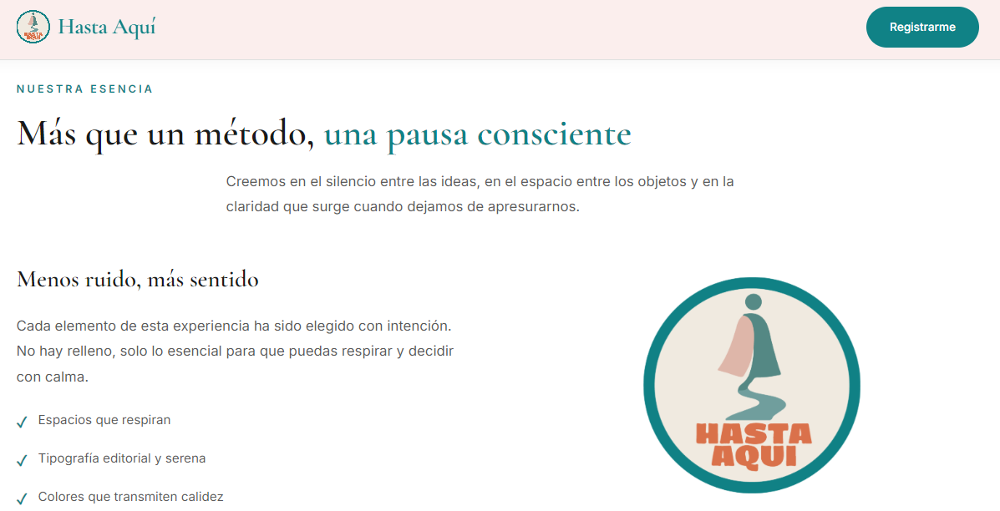

# Hasta Aquí — Landing Page Minimalista

Landing page sofisticada, limpia y con animaciones suaves diseñada para la marca **"Hasta Aquí"**. Transmite claridad, calma y propósito a través de un diseño editorial minimalista con espacios en blanco generosos y una paleta de colores cálida y equilibrada.



---

## ✨ Características

- **Diseño minimalista y elegante**: espacios en blanco generosos, composición aireada y toque artístico.
- **Animaciones al scroll**: elementos que aparecen con efecto fade-up escalonado al hacer scroll (Intersection Observer).
- **Micro-interacciones sutiles**: botones con efecto de escala al presionar y elevación al pasar el cursor.
- **Entrada fluida del hero**: animaciones de entrada escalonadas (badge, título, subtítulo y CTA).
- **Totalmente responsiva**: se adapta correctamente a dispositivos móviles, tablets y escritorios.
- **Menú móvil accesible**: menú hamburguesa con estados de accesibilidad (`aria-expanded`).
- **Contadores animados**: estadísticas que se cuentan numéricamente al llegar al viewport.
- **Contenedor listo para formulario embebido**: bloque `<div id="embedded-form-container">` preparado para insertar tu iframe (Typeform, Tally, Google Forms, etc.).

---

## 🎨 Identidad visual

### Paleta de colores (marca "Hasta Aquí")

| Uso | Color | Hex |
|-----|-------|-----|
| Principal / Acento | Teal / Verde azulado | `#108286` |
| Secundario / Contraste | Mostaza / Oliva oscuro | `#7a6200` |
| Fondo principal | Rosa muy pálido / Marfil suave | `#FBEDEC` |
| Fondo alternativo | Rosa pálido suave | `#f4e3e1` |

### Tipografía

| Elemento | Fuente | Estilo |
|----------|--------|--------|
| Títulos (Headings) | **Cormorant Garamond** | Serif editorial, clásica y moderna |
| Cuerpo (Body) | **Inter** | Sans-serif limpia y altamente legible |

Ambas tipografías se cargan desde [Google Fonts](https://fonts.google.com/).

---

## 📁 Estructura del proyecto

```
Hasta-aqui-Landing/
├── index.html                 # Página principal (HTML5 semántico)
├── css/
│   └── styles.css            # Estilos completos (variables, animaciones, responsive)
├── js/
│   └── script.js             # Lógica de animaciones, contadores y menú móvil
├── src/
│   ├── assets/
│   │   ├── img/
│   │   │   └── hastaaqui.png # Imagen de marca (logo)
│   │   └── favicon/
│   │       ├── favicon.ico
│   │       ├── favicon-32x32.png
│   │       ├── favicon-16x16.png
│   │       ├── apple-touch-icon.png
│   │       ├── site.webmanifest
│   │       └── safari-pinned-tab.svg
└── README.md                 # Este archivo
```

---

## 🚀 Cómo usar

### Opción 1: Abrir directamente
1. Descarga o clona este repositorio.
2. Abre el archivo `index.html` en cualquier navegador moderno.
3. La página funcionará inmediatamente (no requiere servidor ni instalación).

### Opción 2: Con Live Server (recomendado para desarrollo)
1. Instala la extensión **Live Server** en Visual Studio Code.
2. Abre la carpeta del proyecto en VS Code.
3. Haz clic derecho sobre `index.html` → **"Open with Live Server"**.
4. La página se recargará automáticamente al guardar cambios.

> 💡 **Nota:** Si abres `index.html` directamente desde el explorador de archivos (protocolo `file://`), algunos navegadores pueden bloquear la carga de archivos CSS/JS externos. En ese caso, usa Live Server o sube los archivos a un servidor web.

---

## 📝 Personalización

### Cambiar colores de la marca
Edita las variables CSS en `:root` dentro de `css/styles.css`:

```css
:root {
  --color-teal: #108286;
  --color-mustard: #7a6200;
  --color-bg: #FBEDEC;
  /* ... */
}
```

### Insertar tu formulario embebido
Localiza el bloque en `index.html`:

```html
<div id="embedded-form-container">
  <!-- Inserta aquí el <iframe> o código HTML de tu formulario -->
  <div class="form-placeholder">
    <span class="form-icon">📄</span>
    <h3>Tu formulario embebido va aquí</h3>
    <p>Inserta tu <code>&lt;iframe&gt;</code> o código HTML de Typeform, Google Forms, etc.</p>
  </div>
</div>
```

Sustituye el contenido de `.form-placeholder` por el código de tu formulario (por ejemplo, un `<iframe>` de Typeform, Tally o Google Forms).

### Cambiar el logo
Reemplaza la imagen en `src/assets/img/hastaaqui.png` por tu propio archivo y ajusta el tamaño en `css/styles.css`:

```css
.nav-logo-img {
  width: 40px;
  height: 40px;
}
```

---

## 🧩 Secciones de la página

1. **Hero** — Título principal *"Pero sí cambia tu claridad!!"*, subtítulo y botones CTA.
2. **Filosofía** — Mensaje de marca con texto e imagen.
3. **Servicios** — Tres tarjetas: Claridad mental, Diseño consciente y Acompañamiento.
4. **Estadísticas** — Contadores animados (años de experiencia, personas acompañadas, satisfacción).
5. **Testimonios** — Tres citas con autores y profesiones.
6. **Contacto / Formulario** — Información de contacto y contenedor para formulario embebido.
7. **Footer** — Enlaces del sitio, redes sociales y copyright.

---

## 🛠️ Tecnologías utilizadas

- **HTML5** — Estructura semántica y accesible.
- **CSS3** — Variables CSS, Flexbox, Grid, animaciones `@keyframes` y media queries.
- **JavaScript (Vanilla)** — Intersection Observer para animaciones al scroll, contadores numéricos, menú móvil y scroll suave.
- **Google Fonts** — Cormorant Garamond e Inter.

---

## 📄 Licencia

Este proyecto se distribuye bajo la licencia [MIT](LICENSE). Puedes usarlo, modificarlo y distribuirlo libremente.

---

## 🙌 Créditos

Diseñado y desarrollado con intención, minimalismo y calidez para la marca **Hasta Aquí**.

© 2026 Hasta Aquí. Todos los derechos reservados.
